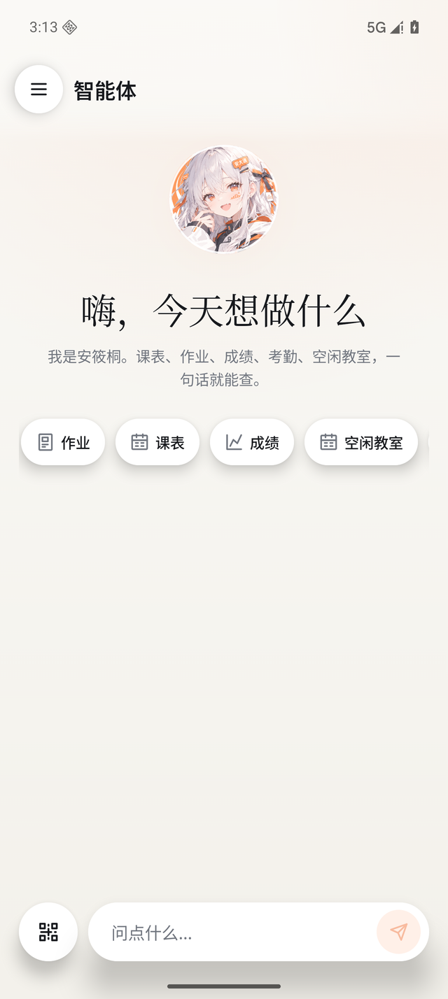
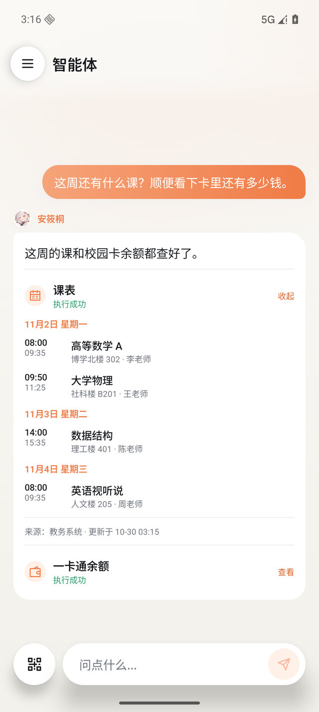
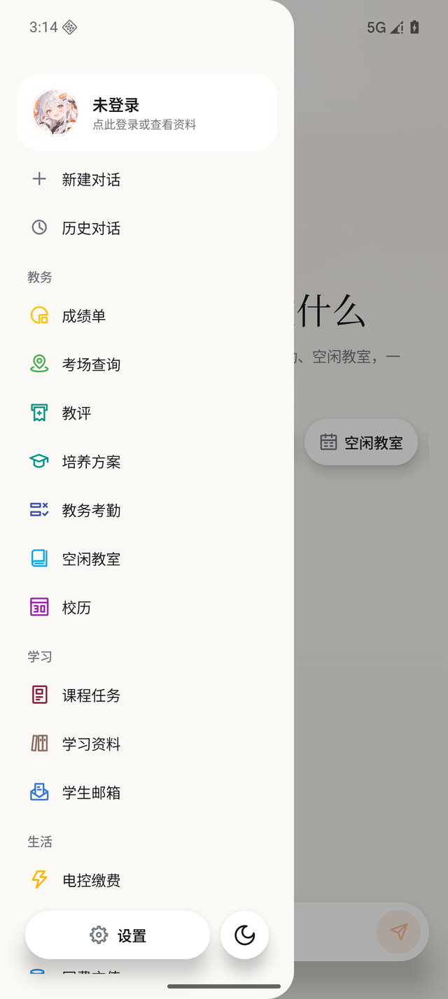
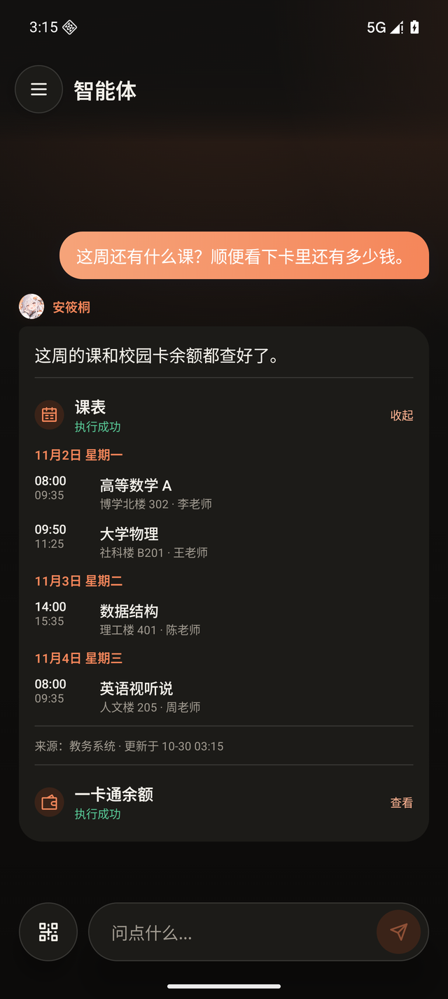
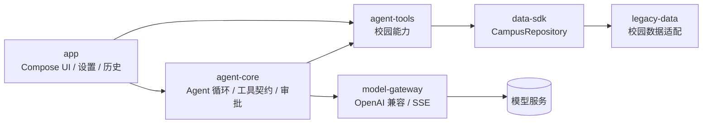

<div align="center">
  
  <h1>安大通 NEXT</h1>
  <p>面向安徽大学的校园 AI 助手</p>
  <p>Android 8.0+，Kotlin 和 Jetpack Compose</p>
  <p><a href="../../releases/latest">下载最新版本</a></p>
</div>

## 功能

在对话框里直接输入需求，可以查课表、作业、成绩、考试、余额、账单、电费、校园通知、空闲教室、失物招领和学生邮箱。加日程、发邮件、评教、失物招领增删和充值会先弹确认。

模型和 API Key 由使用者自己配置，支持 OpenAI 兼容接口。对话、缓存和密钥默认保存在本机，API Key 使用 Android Keystore 加密。

支持亮色和暗色主题，回复是流式的，Markdown 和公式能正常显示。

## 截图

<div align="center">
  
  &nbsp;&nbsp;
  
  &nbsp;&nbsp;
  
</div>

<p align="center"><sub>截图使用演示数据，楼栋名称取自安大校区。</sub></p>

<details>
<summary>暗色模式</summary>
<br>
<div align="center">
  
</div>
</details>

## 结构



| 模块 | 职责 |
| --- | --- |
| `agent-core` | Agent 循环、工具契约、确认与写入保护，纯 Kotlin |
| `model-gateway` | OpenAI 兼容的流式对话与工具调用 |
| `agent-tools` | 面向校园场景的工具实现与结构化结果 |
| `data-sdk` | 校园能力的稳定接口与数据模型 |
| `legacy-data` | 校园数据适配层，负责登录态与真实接口 |
| `app` | Compose 界面、设置、会话历史与整体装配 |

## 运行

需要 JDK 17 和 Android SDK 36，设备为 Android 8.0 及以上。

```bash
./gradlew :app:assembleDebug
```

Debug APK 在 `app/build/outputs/apk/debug/app-debug.apk`。

首次打开后，按引导完成初始化。需要聊天功能时，在「设置 → 模型与性格」填模型服务的 Base URL、模型名和 API Key；需要个人校园数据时，在「设置 → 账号与学习通」登录校园账号。

## 安全与隐私

- 充值、缴费、发邮件、删改内容这类操作会先弹确认，支付密码只在本机使用。
- 网页、邮件、通知、失物招领等外部内容按数据处理，不会当成指令执行。
- 写操作有本地重复提交保护，上一次结果未知时不会自动重试。
- 对话历史、缓存和模型密钥默认存在本机，当前版本没有广告或第三方行为分析 SDK。
- 调用模型时，完成当前任务所需的上下文会发给你配置的服务商。

## English

AHUTong NEXT is an AI-native campus assistant for Anhui University. It handles campus queries and everyday tasks in natural language, with multi-model support, local-first storage, and an extensible set of campus capabilities.

## 致谢

- 感谢 [openahu/ahutong-android](https://github.com/OpenAHU/AHUTong-Android) 提供校园数据层与协议实现。
- 图标来自 [IconPark](https://github.com/bytedance/IconPark)，Apache License 2.0。
- Markdown 与数学公式渲染使用对应的开源组件，遵循其各自许可证。

## License

本项目以 [GPL-3.0](LICENSE) 发布。

---

<p align="center"><sub>本项目为校园开发者发起的非官方项目，与安徽大学官方无隶属关系。截图数据仅用于演示。</sub></p>
