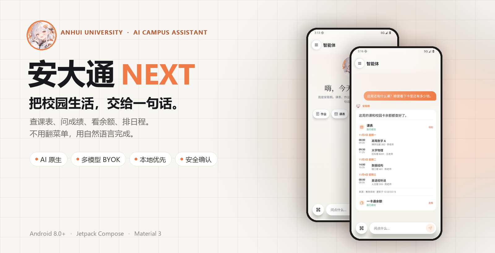
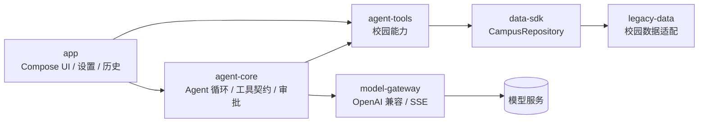

<div align="center">
  
</div>

<h1 align="center">安大通 NEXT</h1>

<p align="center"><strong>把校园生活，交给一句话。</strong></p>
<p align="center">安徽大学 AI 原生校园助手 · Android · Jetpack Compose</p>

<p align="center">
  <a href="../../releases/latest"></a>
  
  
  
</p>

> 安大通 NEXT 是面向安徽大学的 AI 原生校园助手。用自然语言完成校园查询与日常操作，支持多模型接入、本地优先存储与可持续扩展的校园能力。

## 为什么是 NEXT

大多数校园 App 把功能藏进一层层菜单里。NEXT 换了一个入口：**说出你要做的事**。

- **一句话办事**：课表、作业、成绩、考试、余额、账单、电费、通知、失物招领、空闲教室、学生邮箱……不用记入口，直接问。
- **工具调用，不只是聊天**：模型通过结构化工具读取真实数据，结果以原生卡片呈现；需要确认的写操作会停在你面前。
- **自带模型**：兼容 OpenAI 格式的模型服务，填好 Base URL、模型名和 API Key 就能切换，不被单一供应商锁死。
- **本地优先**：对话、缓存和密钥默认留在本机；API Key 使用 Android Keystore 加密保存。
- **安全边界**：网页、邮件、通知等外部内容只当数据，不当指令；充值等真实资金操作必须确认，支付密码不会进入模型上下文。
- **用得舒服**：流式回复、Markdown 与公式渲染、亮暗双主题、可切换的助手性格，以及抽屉里的完整校园工具。

## 截图

<div align="center">
  
  &nbsp;&nbsp;
  
  &nbsp;&nbsp;
  
</div>

<p align="center"><sub>截图中的课程与余额为演示数据；楼栋名称使用安徽大学真实校区。</sub></p>

### 亮暗双主题

<div align="center">
  
  &nbsp;&nbsp;
  
</div>

## 架构



| 模块 | 职责 |
| --- | --- |
| `agent-core` | Agent 循环、工具契约、确认与写入保护，纯 Kotlin |
| `model-gateway` | OpenAI 兼容的流式对话与工具调用 |
| `agent-tools` | 面向校园场景的工具实现与结构化结果 |
| `data-sdk` | 校园能力的稳定接口与数据模型 |
| `legacy-data` | 校园数据适配层，负责登录态与真实接口 |
| `app` | Compose 界面、设置、会话历史与整体装配 |

## 快速开始

**环境**

- JDK 17
- Android SDK 36
- Android 8.0（API 26）及以上设备

**构建**

```bash
./gradlew :app:assembleDebug
```

Debug APK 输出在 `app/build/outputs/apk/debug/app-debug.apk`。

**首次使用**

1. 打开应用，按引导完成初始化。
2. 在「设置 → 模型与性格」填入模型服务的 Base URL、模型名和 API Key。
3. 需要个人校园数据时，在「设置 → 账号与学习通」登录校园账号。

## 安全与隐私

- 高风险操作（充值、缴费、发邮件、删改内容等）必须经过确认卡；支付密码只在本机确认时使用。
- 网页、邮件、通知、失物招领等外部内容会被标记为不可信数据，不应当作指令执行。
- 写操作带有本地幂等保护：上一次结果未知时，不会自动重复提交。
- 对话历史、缓存和模型密钥默认保存在本机；当前版本不包含广告或第三方行为分析 SDK。
- 只有在调用模型时，完成当前任务所需的上下文才会发送给你配置的模型服务商。

## English

AHUTong NEXT is an AI-native campus assistant for Anhui University. It handles campus queries and everyday tasks in natural language, with multi-model support, local-first storage, and an extensible set of campus capabilities.

## 致谢

- 图标来自 [IconPark](https://github.com/bytedance/IconPark)，Apache License 2.0。
- Markdown 与数学公式渲染使用对应的开源组件，遵循其各自许可证。

---

<p align="center"><sub>本项目为校园开发者发起的非官方项目，与安徽大学官方无隶属关系。截图数据仅用于演示。</sub></p>
